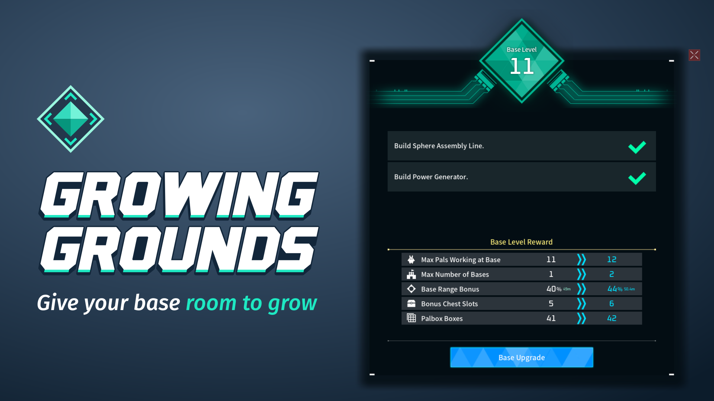
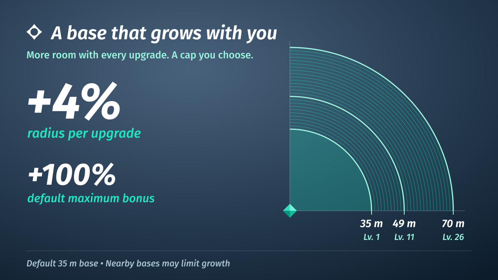
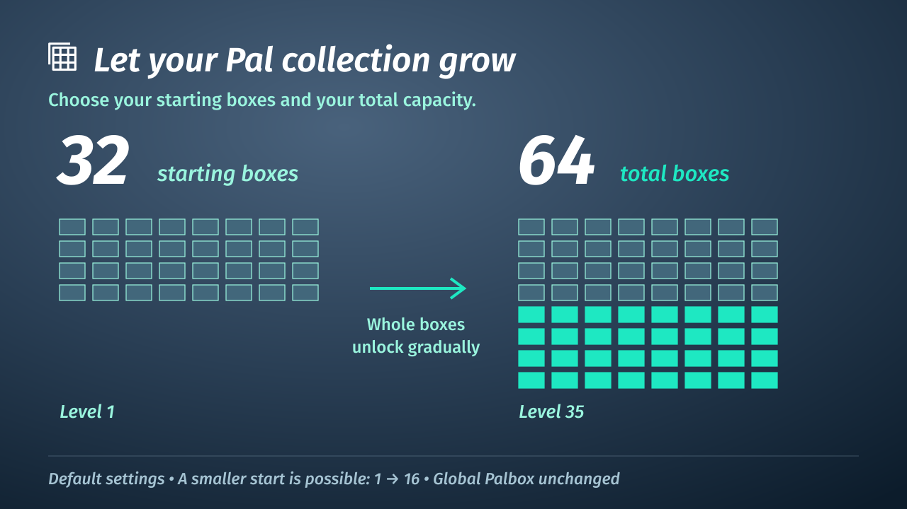

# Growing Grounds



Give your base room to grow—and enjoy the moment it does. Growing Grounds adds meaningful rewards to your base upgrades, with current and next values in the game's own menu.



Choose your gain per upgrade and maximum bonus independently. Defaults give +4% per upgrade, capped at +100%. Nearby bases can limit expansion. Each upgrade celebrates with the blue wave and rising glow.

## More room for supplies

Chests gain 18 bonus slots gradually across the base levels. Guild Chests receive the bonus once for their shared inventory. Occupied extra slots stay until emptied when you lower the cap.



Start with 32 boxes and grow to 64 total—or choose your own start and maximum, such as 1 → 16. Your guild's progression applies once; extra bases do not multiply it. Occupied, locked or open boxes are kept. Global Palbox storage is unchanged.

## Your world. Your pace.

Five controls beside the game’s base/building settings: range gain 0–20% per upgrade (default 4%), range cap 0–300% (default 100%), chest bonus 0–42 in steps of six (default 18), and starting/maximum total Palbox boxes 1–96 (default 32 → 64). Dedicated servers use config.lua.

## Install or update

Requires a compatible **UE4SS loader for Palworld**, installed separately.
The loader must provide `ExecuteInGameThreadWithDelay` and
`LoopInGameThreadWithDelay` (available in the tested Palworld fork **2281fa31**).
Install Growing Grounds on the **host/server and clients**; update both sides
for this version's settings and server-supplied next-range preview.

1. Save and close the game/server, and keep a world backup.
2. Copy the `BaseRangeGrowth` folder into your existing UE4SS `Mods` folder.
   A manual loader normally uses `Pal/Binaries/Win64/ue4ss/Mods/`.
   An existing Workshop loader uses `Mods/NativeMods/UE4SS/Mods/`.
3. Preserve your `config.lua` preferences and any `world-settings.ini` / `.bak`
   files when updating. Add new options from the supplied default config as needed.
4. Restart the server and clients. Allow up to five seconds for the initial row.

**Older configurations:** `maxRangePercent=200` is read as a **+100% bonus**,
with the previous cap preserved. New configurations use `maxRangeBonusPercent=100`.
Existing worlds keep their effective limit; saving World Settings converts the
old key automatically. Choose a higher cap explicitly if you want more room.
Existing `growthPercentPerLevel` values are used again, independently of the
cap, within 0–20%. `0` keeps range growth off; a missing value defaults to 4%.

See [INSTALL.txt](INSTALL.txt) for configuration and removal.
Use your existing loader installation; the mod does not bundle UE4SS or require
PalSchema. Steam Workshop deployment of this mod remains unverified.

## What changes in 0.2.1-beta

Choose your starting and maximum total Palbox boxes; set the range gain and cap
independently. GG now shares one set of setting definitions across calculations,
saved settings and sliders. This update also fixes reconstructed reward rows and
late/recreated settings widgets, and removes the automatic-backup companion.

If upgrading from 0.2.0-beta, preserve your settings, remove the GG launcher
wrapper and replace the mod folder as explained in [INSTALL.txt](INSTALL.txt).
Existing archives are kept. The old `automaticBackups` option is ignored.

See [release notes](publishing/release-0.2.1-beta.txt) for migration details.
Historical notes remain in [publishing/](publishing/).

## Testing and current limits

Tested with Palworld **v1.0.5.102999** and UE4SS Palworld fork **2281fa31**,
using the Windows game and server executables through Proton/Wine, on a
dedicated server with one client. Checked in game across the alpha versions: radius replication
from server to client, the Base Upgrade rows, chest growth and shrinking with
occupied slots kept across a restart, and the upgrade celebration.

For the beta, the dedicated-server test checked Palbox growth, client slot
replication, occupied boxes retained after lowering the cap, and empty-box
shrinking and regrowth. An older solo world expanded to 50 boxes at base level
19. Two Pals placed in box 50 remained in their slots after saving, restoring a
verified archive and restarting the game. The English Base Upgrade panel's
five rows were also checked in game.

Default 0.2.1 rewards and the five World Settings controls were checked natively
through Proton/Wine before the final audit refactor. Its centralized settings and
widget-lifecycle fixes are covered by automated checks, but this final refactor
has not yet had a native game session. Smaller starting Palbox capacities and
their save/reload lifecycle remain unverified.

### Known limits

This is a beta. These still need broader in-game verification:

- larger guilds with multiple simultaneous clients;
- other Palbox capacity mods installed alongside;
- saving World Settings and starting a new world;
- placement rejection near another base;
- Pal work and resource access throughout the expanded area;
- the full reset and removal lifecycle;
- other range mods installed alongside;
- native Windows for this beta, long sessions and other hardware.

The mod's texts follow the game's language, in the 17 languages Palworld
ships. They were written with the game's own vocabulary but not reviewed by
native speakers: corrections are welcome. The celebration can
start late after closing the Palbox; the gameplay radius is already updated.

On a client, while the server's preview is missing or out of date, Base Upgrade keeps
its last complete Growing Grounds values, or shows no Growing Grounds row on a first open.
At the maximum base level only the next value is hidden. With `resetToVanilla=true`
all Growing Grounds rows are hidden.

The server owns gameplay radius. Animation changes the visible boundary only.
Existing bases are not moved or deleted. Overlapping original base circles do
not receive extra growth; other nearby bases may reach a lower cap.

## Configuration

Gameplay options: `growthPercentPerLevel`, `maxRangeBonusPercent`, `maxChestBonusSlots`,
`startingPalboxBoxes`, `maxPalboxBoxes`, `resetToVanilla`.
Visual options: `upgradeAnimation`, `upgradeWave`, `upgradeRibbon`,
`upgradeEffectHeight` (centimetres).

There are no mod keyboard shortcuts or hot reload. An old `debug=true` setting
is ignored. Animations start automatically after a qualifying base upgrade.

## Share your experience

We'd love to see how Growing Grounds fits into your world! Leave a comment,
share a clip, or [report a bug](https://github.com/PikouGame/Growing-Grounds/issues)
so we can investigate and improve it. Game/UE4SS versions, your host/client setup
and steps to reproduce a problem are especially helpful. Please remove personal
information from logs before sharing them.

## Development

Run the Lua checks from this directory:

```sh
lua tests/test_palbox.lua ./
lua tests/test_main.lua ./
lua tests/test_changes.lua ./
lua tests/test_range.lua ./
lua tests/test_settings.lua ./
lua tests/test_storage.lua ./
lua tests/test_chest_ui.lua ./
lua tests/test_objects.lua ./
lua tests/test_preview.lua ./
lua tests/test_ui.lua ./
lua tests/test_wave.lua ./
lua tests/test_motion.lua ./
lua tests/test_texts.lua ./
python3 tools/release.py
```

Release archives use an explicit runtime allowlist. Research exports, private
sidecars, logs and loader binaries are excluded. The internal folder/mod ID stays
`BaseRangeGrowth`. [Workshop notes](publishing/WORKSHOP.txt) describe the unverified
Workshop packaging route.

## Credits and permissions

Built with OpenAI Codex and Claude under lelorax's direction, including code,
documentation and the original icon/glow assets. The author chose the behavior,
tested it in game and supplies real gameplay media. No generated gameplay
imagery or third-party game files are bundled.

Growing Grounds is unofficial. Palworld and its game assets belong to their
respective owners. Follow [Pocketpair's mod guidelines](https://guideline.palworldgame.com/palworld-mod-guideline).

All rights reserved. Downloading and using the mod is allowed. Redistribution,
published modifications and reuse require permission; see [LICENSE.txt](LICENSE.txt).
