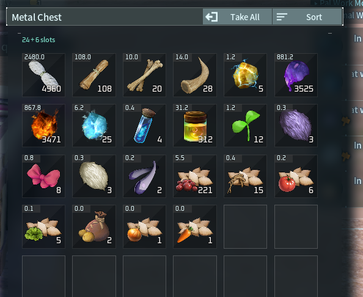
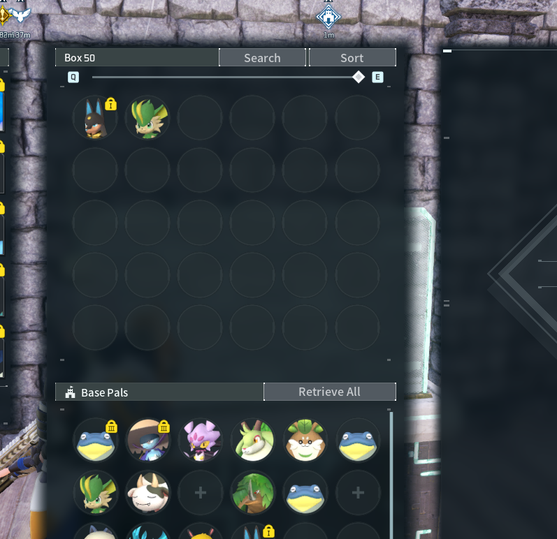

## Give your base room to grow

Grow your base from its first upgrade to its last: **+100% radius** by level 35 with the default settings. The Base Upgrade screen shows your current and next range, chest slots and Palbox boxes. Celebrate each expansion with a blue wave from the Palbox, a gentle bounce and a rising glow.

*Celebration captured in an earlier version, at original speed; initial wait trimmed.*

## More room for your supplies

Chests gain **18 bonus slots** by default, spread gradually across all base levels. Guild Chests receive the bonus once for their shared inventory. Open a chest to see its original capacity plus its extra slots above the grid.

## More boxes for your Pals

Your regular Palbox gains **one extra box per base upgrade**, starting at level 2. The default cap is **32 extra boxes**, reached at level 33. The bonus follows your guild level once; extra bases do not multiply it. **Global Palbox storage is unchanged.**

## Make it your own

Three caps in **World Settings**, or in the dedicated-server config:
• **Range:** 0 to +300%; default +100%, spread across all base levels and rounded to whole percentages.
• **Chest slots:** 0 to 42 in steps of six; default 18. Slots still arrive gradually, one at a time.
• **Palbox boxes:** 0 to 64 extra; default 32. One box per upgrade means level 35 can earn at most 34 extra boxes even with a higher cap.

Set any cap to **0 (Off)** to disable that bonus. Nearby bases can limit range growth. Lowering a storage cap keeps occupied extra slots or boxes until you empty them.

## Updating from 0.1.7 or earlier

**The new range curve can shrink existing bases.** With the default cap, a level-11 base goes from 49 m to 45.2 m. Check buildings near the edge and back up before updating. Old chest caps round to the nearest multiple of six: 20 becomes 18, 40 becomes 42. Keep your config.lua and world-settings.ini.

## Getting started

Install the complete mod on the **host/server and clients**, using your existing compatible **Palworld UE4SS loader**. Update both sides together. Tested with Palworld 1.0.5.102999 and the UE4SS Palworld fork g2281fa31.

**0.2.0-beta:** solo and dedicated-server tests passed through Proton/Wine. Testing this beta on a physical Windows/Steam installation is still pending.

[Installation guide](https://github.com/PikouGame/Growing-Grounds/blob/main/INSTALL.txt) · [Compatibility and known issues](https://github.com/PikouGame/Growing-Grounds#testing-and-current-limits)

## Share your experience

We’d love to see what you build! Share your base, leave a comment, or [report a bug](https://github.com/PikouGame/Growing-Grounds/issues) so we can keep improving Growing Grounds together.

*Made with OpenAI Codex and Claude under lelorax’s direction. Gameplay and UI captured in game. Free to use; all rights reserved for GG. Reuploads, published modifications and reuse require permission. Unofficial Palworld mod.*
