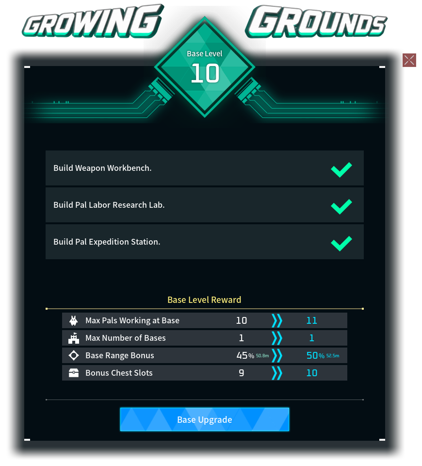
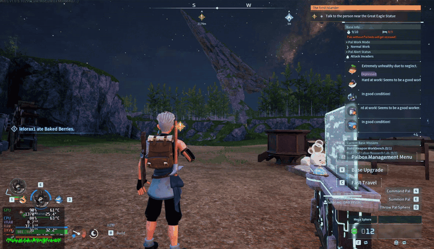
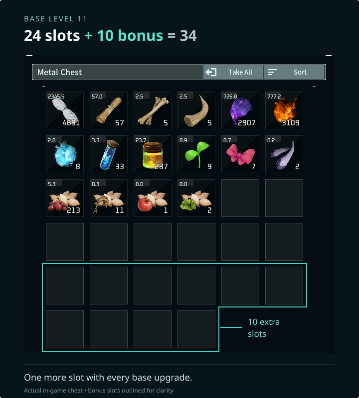

## Give your base room to grow

Gain **4% of your original base radius per level**, starting at level 2, up to **double the radius** by default. Celebrate each expansion with a blue wave from the Palbox, a gentle bounce, and a rising glow.

_Gameplay excerpt at original speed; initial wait trimmed._

## More room for your supplies

Chests grow with your base: **20 bonus slots** by default, arriving steadily from your first upgrade to the final base level. Guild Chests benefit too, with the bonus applied once to their shared inventory.

## Make it your own

Adjust growth and both caps in **World Settings**, or in the server config:

- **Range growth:** 0–20% per level.
- **Range bonus cap:** up to +300%; +100% doubles the radius.
- **Chest bonus cap:** up to 40 extra slots.

Set either cap to **0 (Off)** to disable that bonus. Nearby bases can limit expansion. Lowering the chest cap keeps occupied extra slots until you empty them.

## Getting started

Install on the **host/server and clients** with a compatible **Palworld UE4SS loader**. Back up your world before installing, and keep your settings when updating.

[Installation guide](https://github.com/PikouGame/Growing-Grounds/blob/main/INSTALL.txt) · [Compatibility and known issues](https://github.com/PikouGame/Growing-Grounds#testing-and-current-limits)

## Share your experience

We’d love to see what you build! Share your base, leave a comment, or [report a bug](https://github.com/PikouGame/Growing-Grounds/issues) so we can keep improving Growing Grounds together.

_Made with OpenAI Codex under lelorax’s direction. Gameplay and UI captured in game; AI-assisted title lettering. Free to use; all rights reserved. Reuploads, published modifications and reuse require permission. Unofficial Palworld mod._
