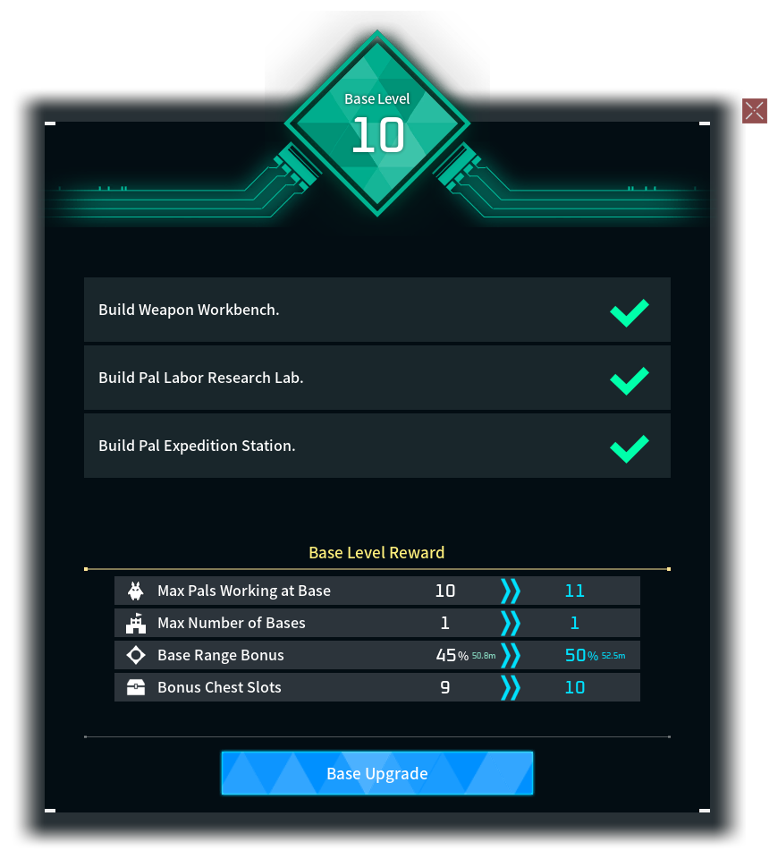

# Growing Grounds

_Room to grow. A moment to celebrate._

Your base gains **5% of its original radius per level**, starting at level 2. See the current and next bonus, with metres beside each value, in the Base Upgrade menu.

A blue wave travels from the Palbox to the boundary, followed by a gentle bounce and rising glow.

_Gameplay excerpt at original speed; initial wait trimmed._

Chests gain **one extra slot per upgrade**, up to **20 bonus slots** by default. Guild Chests receive the bonus once for their shared inventory. The upgrade menu previews the current and next slot bonus. Lowering the cap keeps occupied extra slots until you empty them.

## Make it your own

Choose **0–20% growth per level**, a **0 to +300% range bonus cap**, and **0–40 bonus chest slots**. Set either cap to **0 (Off)** to disable it. The default range cap is +100%: double the original radius. +300% means four times the radius.

Local hosts get sliders in World Settings; dedicated-server owners use `config.lua`. Nearby bases can limit expansion, and new Palboxes reserve room for future growth. Existing settings keep their previous effective range cap.

## Getting started

Requires a compatible **Palworld UE4SS loader on the host/server and clients**.

1. Close the game/server and back up your world.
2. Copy `BaseRangeGrowth` into your existing UE4SS `Mods` folder on both sides.
3. Keep `config.lua` and `world-settings.ini` when updating; add new options from the supplied config as needed.

See `INSTALL.txt` for details. No development hotkeys are included.

This is an alpha. The celebration can still start late after closing the Palbox. Tested on Palworld v1.0.5.102999 using Windows builds through Proton/Wine; see the README for compatibility notes.

## Share your experience

We’d love to hear how it feels in your world! Share your base, leave a comment, or report a bug so we can investigate and improve it together.

[Report a bug](https://github.com/PikouGame/Growing-Grounds/issues) · [Source and compatibility notes](https://github.com/PikouGame/Growing-Grounds)

_Made with OpenAI Codex under lelorax’s direction. Media is captured in game. Free to use; all rights reserved. Reuploads, published modifications and reuse require permission. Unofficial Palworld mod._
