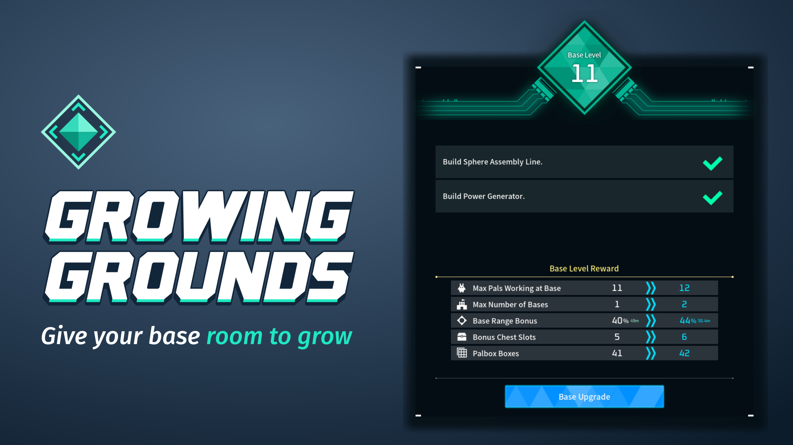
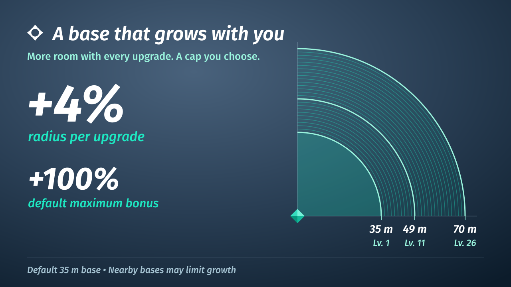
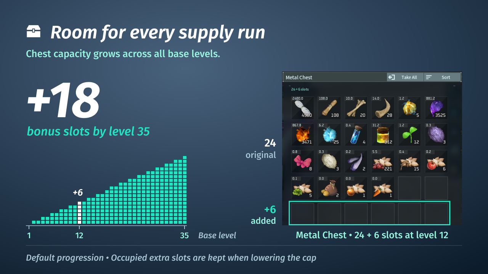
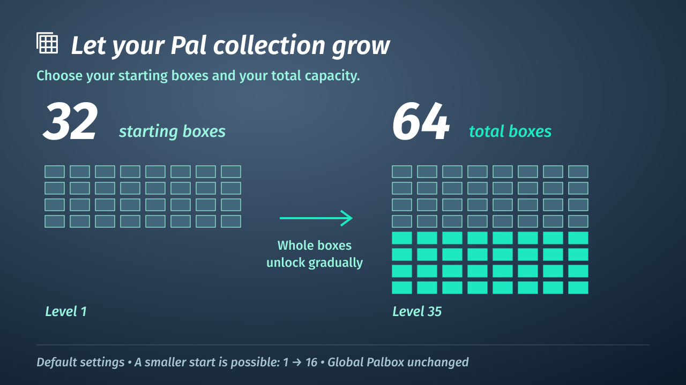
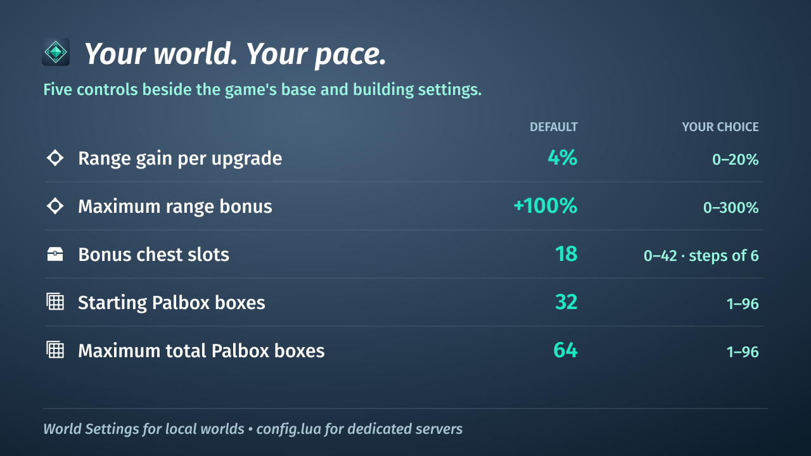

Give your base room to grow—and enjoy the moment it does. Every base upgrade brings more range, more chest slots and more Palbox boxes, with current and next values shown in the game's own menu.

Choose your gain per upgrade and maximum bonus independently. Defaults give +4% per upgrade, capped at +100%. Nearby bases can limit expansion. Each upgrade celebrates with the blue wave and rising glow.

Chests gain up to 18 bonus slots, spread across the base levels. Guild Chests receive the bonus once for their shared inventory. Occupied extra slots stay until emptied when you lower the cap.

Start with 32 boxes and grow to 64 total—or choose your own start and maximum, such as 1 → 16. Your guild's progression applies once; extra bases do not multiply it. Occupied, locked or open boxes are kept. Global Palbox storage is unchanged.

Five controls sit beside the game’s base and building settings: range gain, range cap, chest slots, and starting and maximum Palbox boxes. Dedicated servers use config.lua.

## Getting started

Install on the host/server and on every client with a compatible Palworld UE4SS loader, and keep both sides on the same version. When updating, keep your config.lua and world-settings files. Coming from 0.2.0-beta? Its backup companion is gone: follow the installation guide. Checked in game through Proton/Wine; native Windows and Palbox starts below 32 are not tested yet.

[Installation](https://github.com/PikouGame/Growing-Grounds/blob/main/INSTALL.txt) · [Compatibility and known issues](https://github.com/PikouGame/Growing-Grounds#testing-and-current-limits)

## Share your experience

We'd love to see what you build! Share your base, leave a comment, or [report a bug](https://github.com/PikouGame/Growing-Grounds/issues) so we can investigate and improve Growing Grounds together.

Made with OpenAI Codex and Claude under LeLorax's direction. Unofficial Palworld mod. Free to use; reuploads, published modifications and reuse require permission.
