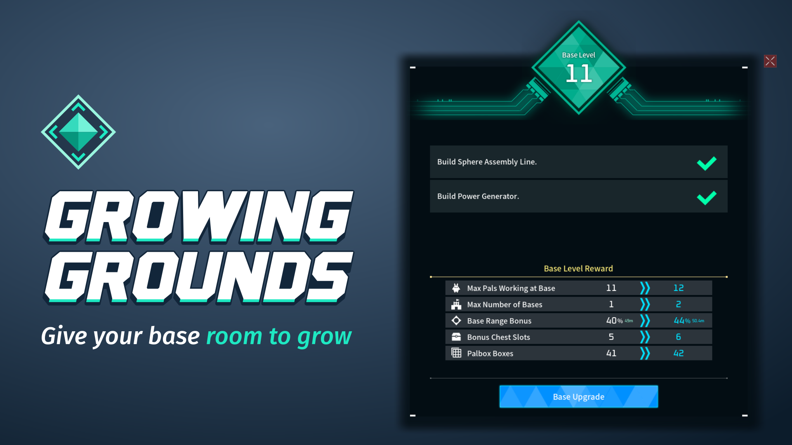
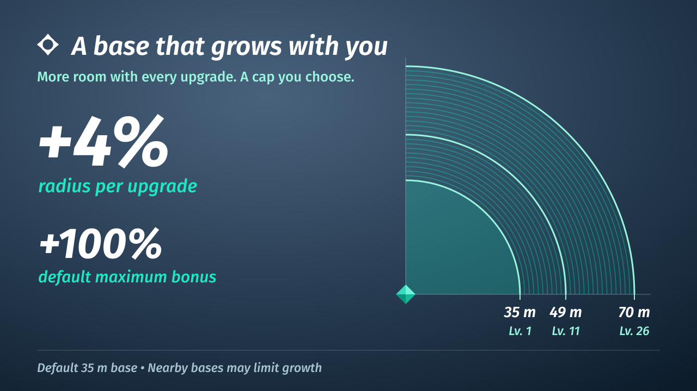
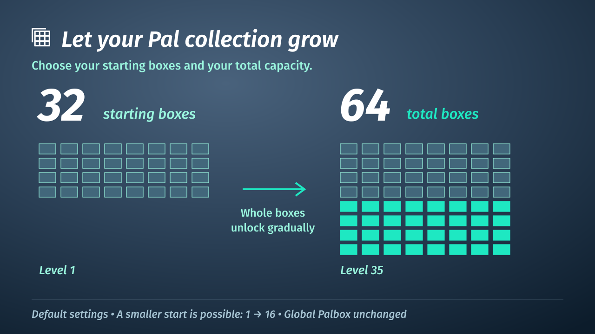

# Growing Grounds

Give your base room to grow—and enjoy the moment it does. Growing Grounds adds meaningful rewards to your base upgrades, with current and next values in the game's own menu.

Choose your gain per upgrade and maximum bonus independently. Defaults give +4% per upgrade, capped at +100%. Nearby bases can limit expansion. Each upgrade celebrates with the blue wave and rising glow.

## More room for supplies

Chests gain 18 bonus slots gradually across the base levels. Guild Chests receive the bonus once for their shared inventory. Occupied extra slots stay until emptied when you lower the cap.

Start with 32 boxes and grow to 64 total—or choose your own start and maximum, such as 1 → 16. Your guild's progression applies once; extra bases do not multiply it. Occupied, locked or open boxes are kept. Global Palbox storage is unchanged.

## Your world. Your pace.

Five controls beside the game’s base/building settings: range gain 0–20% per upgrade (default 4%), range cap 0–300% (default 100%), chest bonus 0–42 in steps of six (default 18), and starting/maximum total Palbox boxes 1–96 (default 32 → 64). Dedicated servers use config.lua.

